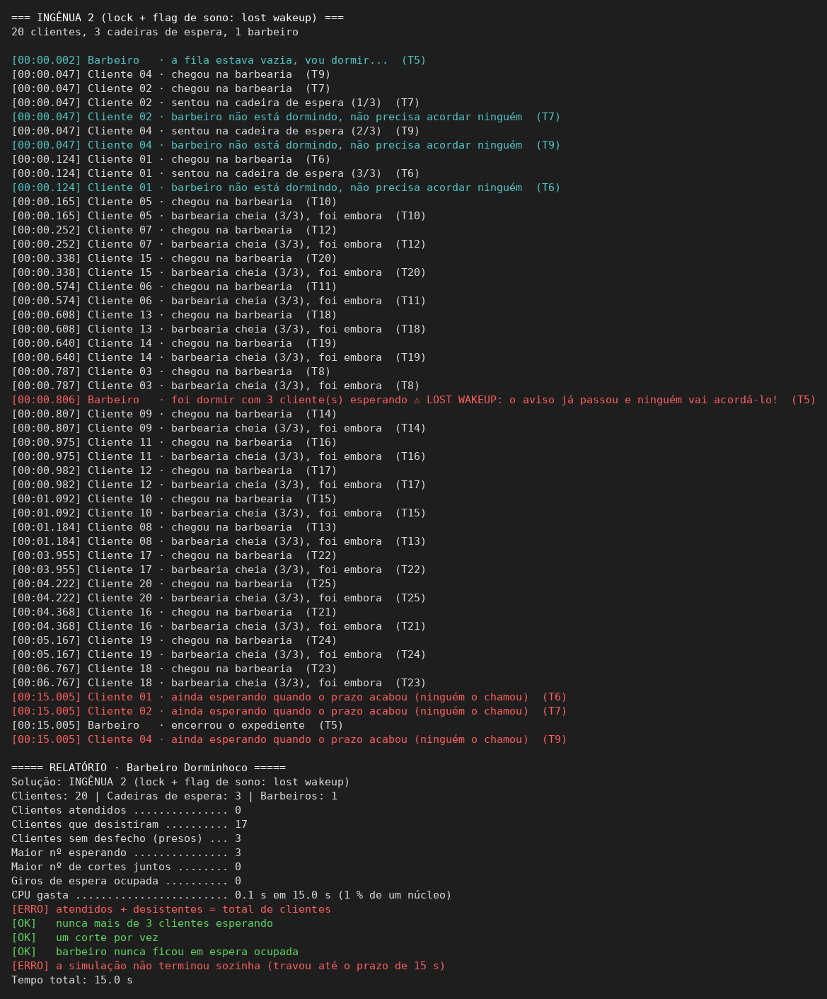
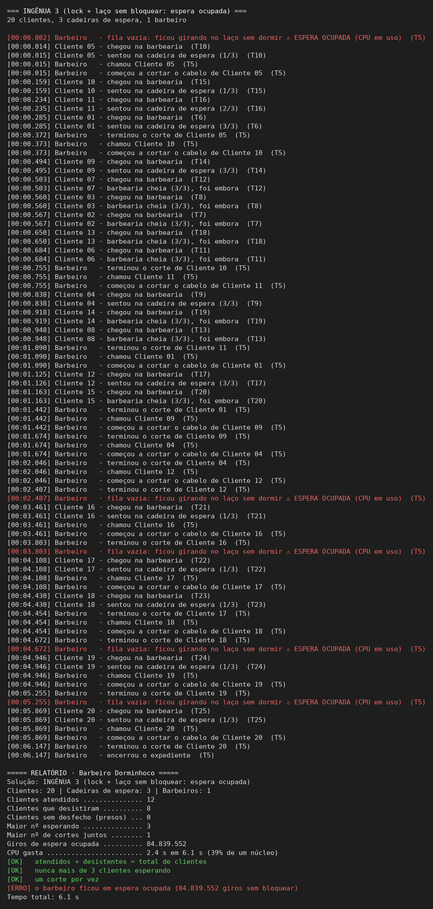

# Barbeiro Dorminhoco em C# (.NET 10)

**Disciplina:** Desenvolvimento para Concorrência (ESW240) · UniRV · Engenharia de Software · Trabalho N3
**Problema escolhido:** nº 4 · Barbeiro Dorminhoco (Aula 10)
**Alunos:**
- Bruno Gabriel Guimarães Fernandes
- João Víctor Severino da Silva

> Status: **Entregas 0, 1 e 2** concluídas (estudo do problema, cenário + Ingênua 1, demais ingênuas + menu).
> Faltam a solução ideal, a comparação de desempenho e o README final (Entregas 3 e final).

---

## 1. O problema

Uma barbearia tem **1 barbeiro**, **1 cadeira de corte** e **3 cadeiras de espera**. Chegam **20 clientes** em momentos aleatórios.

- Sem clientes, o barbeiro **dorme**.
- Cliente que chega e encontra o barbeiro dormindo **o acorda**.
- Se o barbeiro está ocupado e há cadeira de espera livre, o cliente **senta e espera**.
- Se as 3 cadeiras estão ocupadas, o cliente **vai embora** (desiste).

## 2. Quem são as threads e o que elas disputam

Cada participante é uma `Task` (criada com `TaskCreationOptions.LongRunning`, ou seja, uma thread dedicada), com tempos aleatórios via `Random.Shared`.

| Thread (Task) | Quantidade | O que faz |
|---|---|---|
| `Barbeiro` | 1 | Pega o próximo cliente da fila, corta o cabelo (200–400 ms) e repete. Dorme se a fila está vazia. |
| `Cliente` | 20 | Chega após um atraso aleatório (0–1500 ms), tenta sentar; se conseguir, espera o corte; se não, vai embora. |

**Recursos disputados (estado compartilhado):**

| Recurso | Quem disputa | Risco sem proteção |
|---|---|---|
| As **3 cadeiras de espera** (contador/fila de clientes esperando) | Os 20 clientes entre si e o barbeiro (que retira clientes da fila) | Race condition: mais de 3 clientes sentados |
| O **estado do barbeiro** (dormindo/acordado) | Clientes que acordam e o barbeiro que dorme | Lost wakeup: barbeiro dorme com cliente esperando |
| A **cadeira de corte** (um corte por vez) | O barbeiro (e os clientes que esperam ser chamados) | Dois cortes ao mesmo tempo / cliente atendido duas vezes |

## 3. Regras de um acesso seguro

1. **Verificar e ocupar uma cadeira é uma operação só.** O teste "há cadeira livre?" e o incremento do contador de clientes esperando precisam acontecer juntos, dentro de um mesmo `lock`. Nunca ler fora e gravar depois.
2. **Nunca mais que 3 clientes esperando.** Com as cadeiras cheias, o cliente desiste na hora, sem bloquear e sem entrar na fila.
3. **O aviso ao barbeiro não pode se perder.** Quem chega e quem dorme se comunicam por semáforos, que guardam o sinal mesmo que o barbeiro ainda não tenha começado a esperar. Flag booleana não guarda.
4. **Um corte por vez, em ordem.** O cliente só é cortado depois que o barbeiro o chamou, e o barbeiro só chama o próximo depois de terminar o atual (handshake entre os dois semáforos).

## 4. Soluções que serão implementadas

### Soluções ingênuas

| # | Solução | Problema que deve provocar | Status |
|---|---|---|---|
| **Ingênua 1** | Nenhum controle de concorrência: fila e flags comuns, `if (Count < 3)` seguido de `Enqueue` | **Race condition** (check-then-act): vários clientes passam pelo `if` ao mesmo tempo e sentam, ficando mais de 3 esperando | **Pronta (Entrega 1)** |
| **Ingênua 2** | `lock` apenas ao redor do contador, mas o barbeiro "dorme" com uma flag booleana e `Thread.Sleep`, sem semáforo | **Lost wakeup**: o barbeiro vê a fila vazia, mas antes de marcar que dorme um cliente chega, vê "acordado" e não avisa ninguém. O barbeiro dorme com cliente esperando | **Pronta (Entrega 2)** |
| **Ingênua 3** | `lock` correto, mas o barbeiro espera em laço sem bloquear (`while (fila vazia) { }`) | **Espera ocupada**: um núcleo da CPU fica a 100% enquanto não há cliente | **Pronta (Entrega 2)** |

### Solução ideal

- **Ferramenta:** dois `SemaphoreSlim(0)` (um de clientes, outro de barbeiro) e um contador de clientes esperando protegido por `lock`, conforme a seção 4 do enunciado e a Aula 10.
- **Por que resolve:** o contador sob `lock` torna "verificar e sentar" atômico (regras 1 e 2). O semáforo `clientes` guarda o aviso mesmo que o barbeiro ainda não esteja esperando (regra 3), e o semáforo `barbeiro` faz o handshake do corte (regra 4). O barbeiro bloqueia sem gastar CPU.
- **Término:** o programa termina sozinho quando os 20 clientes são atendidos ou desistem, com um `CancellationTokenSource` com prazo como rede de segurança.

### As verificações automáticas do relatório

1. `[OK]` **Atendidos + desistentes = 20** (nenhum cliente perdido ou contado duas vezes).
2. `[OK]` **Nunca mais de 3 clientes esperando ao mesmo tempo.**
3. `[OK]` **Um corte por vez** (no máximo 1 corte em andamento).
4. `[OK]` **Barbeiro nunca ficou em espera ocupada** (extra, adicionada na Entrega 2 para provar o problema da Ingênua 3).

---

## 5. Como executar

Requer o SDK do .NET 10.

```bash
cd BarbeiroDorminhoco
dotnet run              # abre o menu
dotnet run -- 2         # executa direto uma opção (1, 2 ou 3)
```

| Opção | O que faz |
|---|---|
| 1 | Ingênua 1: sem controle de concorrência (race condition) |
| 2 | Ingênua 2: lock + flag de sono (lost wakeup). **Trava até o prazo de 15 s**, é o esperado |
| 3 | Ingênua 3: laço sem bloquear (espera ocupada) |
| 4 | Solução ideal (Entrega 3, ainda não implementada) |
| 5 | Comparar desempenho (Entrega 3, ainda não implementada) |
| 0 | Sair |

Todo o cenário (clientes, cadeiras, tempos, janelas de erro e prazo) está em `Config.cs`.

## 6. Estrutura do código

| Arquivo | Responsabilidade |
|---|---|
| `Config.cs` | Todo o cenário em um lugar: nº de clientes, cadeiras, tempos, janelas de erro e prazo (requisito 1) |
| `Logger.cs` | Log de cada evento com horário e autor, ex.: `[00:00.944] Cliente 13 · sentou na cadeira de espera (4/3)` |
| `Estatisticas.cs` | Contadores usados no relatório (instrumentação, não faz parte do problema) |
| `Modelo/Cliente.cs` | Participante: cada cliente é uma `Task` com chegada aleatória (uma rajada no começo e alguns retardatários) |
| `Modelo/Barbeiro.cs` | Participante: o barbeiro é uma `Task` que corta um cliente por vez |
| `Modelo/IBarbearia.cs` | Contrato do recurso compartilhado; cada solução o implementa e `Cliente`/`Barbeiro` não mudam |
| `Solucoes/BarbeariaIngenua1.cs` | Ingênua 1, sem controle de concorrência |
| `Solucoes/BarbeariaIngenua2.cs` | Ingênua 2, lock + flag de sono |
| `Solucoes/BarbeariaIngenua3.cs` | Ingênua 3, lock + laço sem bloquear |
| `Simulacao.cs` | Monta as Tasks, executa e mede tempo e CPU |
| `Relatorio.cs` | Contadores e verificações `[OK]` / `[ERRO]` |
| `Menu.cs` | Menu do console com uma opção por solução |

O relatório já traz os contadores do problema: atendidos, desistentes, presos (sem desfecho), maior nº esperando, maior nº de cortes simultâneos, giros de espera ocupada e CPU gasta, seguidos das verificações.

## 7. Soluções ingênuas: o que dá errado

### Ingênua 1 · race condition (opção 1)

Código em `Solucoes/BarbeariaIngenua1.cs`:

```csharp
if (_cadeirasDeEspera.Count < Config.CadeirasEspera)   // LER: há cadeira livre?
{
    Thread.Sleep(...);                                 // janela do erro
    _cadeirasDeEspera.Enqueue(cliente);                // GRAVAR: senta
}
```

**Por que acontece:** entre o teste e o `Enqueue`, outros clientes também passam pelo `if`, pois ninguém ocupou a cadeira ainda. Todos veem "há vaga", todos sentam e ficam mais de 3 clientes em 3 cadeiras. O `Thread.Sleep` só alarga a janela para o erro aparecer em toda execução (como o enunciado sugere); sem ele a falha existiria do mesmo jeito, só que mais rara. Sem proteção, a própria `Queue` também não é thread-safe.

**Como aparece:** a linha vermelha do log e o `[ERRO]` no relatório.

```
[00:00.897] Cliente 03 · barbearia cheia (3/3), foi embora
[00:00.944] Cliente 13 · sentou na cadeira de espera (4/3) ⚠ RACE CONDITION: mais clientes que cadeiras!
...
Maior nº esperando ............... 4
[OK]   atendidos + desistentes = total de clientes
[ERRO] nunca mais de 3 clientes esperando
[OK]   um corte por vez
```


Texto completo em [`docs/prints/ingenua1-log.txt`](docs/prints/ingenua1-log.txt). Nas execuções de teste o problema apareceu em 14 de 14 rodadas.

### Ingênua 2 · lost wakeup (opção 2)

Aqui as cadeiras já estão corretas (tudo sob `lock`). O defeito está no jeito de dormir, em `Solucoes/BarbeariaIngenua2.cs`:

```csharp
// PASSO 1: olhou a fila e ela estava vazia
Thread.Sleep(Config.JanelaLostWakeupMs);   // janela: um cliente pode chegar aqui
lock (_lock) { _barbeiroDormindo = true; } // PASSO 2: só agora marca que dorme
_acordar.Wait(ct);                         // dorme esperando um sinal
```

**Por que acontece:** o cliente só chama `_acordar.Set()` se a flag `_barbeiroDormindo` já estiver marcada. Quem chega entre os passos 1 e 2 vê o barbeiro "acordado", senta sem avisar ninguém, e logo depois o barbeiro marca a flag e dorme com cliente na cadeira. O aviso já passou, e uma flag booleana não guarda aviso (um semáforo guardaria). Com as 3 cadeiras ocupadas, os clientes seguintes desistem sem tentar acordar o barbeiro, então ninguém o acorda. O programa fica travado até o prazo de 15 s.

**Como aparece:** o barbeiro vai dormir com 3 clientes esperando, ninguém é atendido e a simulação não termina sozinha.

```
[00:00.047] Cliente 02 · barbeiro não está dormindo, não precisa acordar ninguém
[00:00.806] Barbeiro   · foi dormir com 3 cliente(s) esperando ⚠ LOST WAKEUP: o aviso já passou e ninguém vai acordá-lo!
[00:15.005] Cliente 01 · ainda esperando quando o prazo acabou (ninguém o chamou)
...
Clientes atendidos ............... 0
Clientes sem desfecho (presos) ... 3
[ERRO] atendidos + desistentes = total de clientes
[ERRO] a simulação não terminou sozinha (travou até o prazo de 15 s)
```



Texto completo em [`docs/prints/ingenua2-log.txt`](docs/prints/ingenua2-log.txt). Nas execuções de teste o problema apareceu em 10 de 10 rodadas.

### Ingênua 3 · espera ocupada (opção 3)

Cadeiras e sono estão corretos, mas o barbeiro nunca dorme de verdade. Em `Solucoes/BarbeariaIngenua3.cs`:

```csharp
while (!ct.IsCancellationRequested)
{
    lock (_lock) { if (_cadeirasDeEspera.Count > 0) cliente = _cadeirasDeEspera.Dequeue(); }
    if (cliente is not null) return cliente;
    giros++;          // nada de Sleep, Wait ou semáforo: volta direto a perguntar
}
```

**Por que acontece:** sem um mecanismo que bloqueie a thread até chegar cliente, o barbeiro pergunta "chegou alguém?" sem parar. O resultado do atendimento sai certo (as verificações de cadeiras passam), mas a CPU fica ocupada e o `lock` é disputado sem necessidade. Um semáforo faria a thread dormir de verdade.

**Como aparece:** dezenas de milhões de giros e CPU alta enquanto o barbeiro está ocioso.

```
[00:00.002] Barbeiro   · fila vazia: ficou girando no laço sem dormir ⚠ ESPERA OCUPADA (CPU em uso)
...
Giros de espera ocupada .......... 84.839.552
CPU gasta ........................ 2.4 s em 6.1 s (39% de um núcleo)
[OK]   atendidos + desistentes = total de clientes
[OK]   nunca mais de 3 clientes esperando
[OK]   um corte por vez
[ERRO] o barbeiro ficou em espera ocupada (84.839.552 giros sem bloquear)
```



Texto completo em [`docs/prints/ingenua3-log.txt`](docs/prints/ingenua3-log.txt). Para comparação, as outras soluções fecham com 0 giros.

**Observação sobre a Ingênua 1:** nela os clientes e o barbeiro esperam consultando campos em laço com `Thread.Sleep(5)`. Isso é só para o cenário rodar sem nenhuma primitiva de sincronização; o foco dessa solução é a race condition. O `lock` do `Logger` e o `Interlocked` das `Estatisticas` são instrumentação (evitam linhas misturadas no console e contagem errada) e não protegem nenhum estado do problema.

---

## Ferramentas de IA usadas

- Claude (Anthropic): geração do código-base e dos rascunhos do README, revisados e executados pelos alunos.
