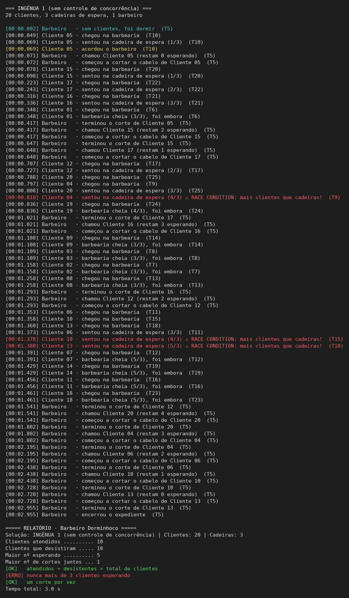

# Barbeiro Dorminhoco em C# (.NET 10)

**Disciplina:** Desenvolvimento para Concorrência (ESW240) · UniRV · Engenharia de Software · Trabalho N3
**Problema escolhido:** nº 4 · Barbeiro Dorminhoco (Aula 10)
**Alunos:**
- Bruno Gabriel Guimarães Fernandes
- João Víctor Severino da Silva

> Status: **Entrega 0** (estudo do problema) e **Entrega 1** (cenário + Solução Ingênua 1) concluídas.
> As demais soluções estão planejadas abaixo e serão adicionadas nas próximas entregas.

---

## 1. O problema

Uma barbearia tem **1 barbeiro**, **1 cadeira de corte** e **3 cadeiras de espera**. Chegam **20 clientes** em momentos aleatórios.

- Sem clientes, o barbeiro **dorme**.
- Cliente que chega e encontra o barbeiro dormindo **o acorda**.
- Se o barbeiro está ocupado e há cadeira de espera livre, o cliente **senta e espera**.
- Se as 3 cadeiras estão ocupadas, o cliente **vai embora** (desiste).

## 2. Quem são as threads e o que elas disputam

Cada participante é uma `Task` (criada com `TaskCreationOptions.LongRunning`, ou seja, uma thread dedicada), com tempos aleatórios via `Random.Shared`.

| Thread (Task) | Quantidade | O que faz |
|---|---|---|
| `Barbeiro` | 1 | Pega o próximo cliente da fila, corta o cabelo (200–400 ms) e repete. Dorme se a fila está vazia. |
| `Cliente` | 20 | Chega após um atraso aleatório (0–1500 ms), tenta sentar; se conseguir, espera o corte; se não, vai embora. |

**Recursos disputados (estado compartilhado):**

| Recurso | Quem disputa | Risco sem proteção |
|---|---|---|
| As **3 cadeiras de espera** (contador/fila de clientes esperando) | Os 20 clientes entre si e o barbeiro (que retira clientes da fila) | Race condition: mais de 3 clientes sentados |
| O **estado do barbeiro** (dormindo/acordado) | Clientes que acordam e o barbeiro que dorme | Lost wakeup: barbeiro dorme com cliente esperando |
| A **cadeira de corte** (um corte por vez) | O barbeiro (e os clientes que esperam ser chamados) | Dois cortes ao mesmo tempo / cliente atendido duas vezes |

## 3. Regras de um acesso seguro

1. **Verificar e ocupar uma cadeira é uma operação só.** O teste "há cadeira livre?" e o incremento do contador de clientes esperando precisam acontecer juntos, dentro de um mesmo `lock`. Nunca ler fora e gravar depois.
2. **Nunca mais que 3 clientes esperando.** Com as cadeiras cheias, o cliente desiste na hora, sem bloquear e sem entrar na fila.
3. **O aviso ao barbeiro não pode se perder.** Quem chega e quem dorme se comunicam por semáforos, que guardam o sinal mesmo que o barbeiro ainda não tenha começado a esperar. Flag booleana não guarda.
4. **Um corte por vez, em ordem.** O cliente só é cortado depois que o barbeiro o chamou, e o barbeiro só chama o próximo depois de terminar o atual (handshake entre os dois semáforos).

## 4. Soluções que serão implementadas

### Soluções ingênuas

| # | Solução | Problema que deve provocar | Status |
|---|---|---|---|
| **Ingênua 1** | Nenhum controle de concorrência: fila e flags comuns, `if (Count < 3)` seguido de `Enqueue` | **Race condition** (check-then-act): vários clientes passam pelo `if` ao mesmo tempo e sentam, ficando mais de 3 esperando | **Pronta (Entrega 1)** |
| **Ingênua 2** | `lock` apenas ao redor do contador, mas o barbeiro "dorme" com uma flag booleana e `Thread.Sleep`, sem semáforo | **Lost wakeup**: o barbeiro vê a fila vazia, mas antes de marcar que dorme um cliente chega, vê "acordado" e não avisa ninguém. O barbeiro dorme com cliente esperando | Entrega 2 |
| **Ingênua 3** (se der tempo) | `lock` correto, mas o barbeiro espera em laço sem bloquear (`while (fila vazia) { }`) | **Espera ocupada**: um núcleo da CPU fica a 100% enquanto não há cliente | Entrega 2 |

### Solução ideal

- **Ferramenta:** dois `SemaphoreSlim(0)` (um de clientes, outro de barbeiro) e um contador de clientes esperando protegido por `lock`, conforme a seção 4 do enunciado e a Aula 10.
- **Por que resolve:** o contador sob `lock` torna "verificar e sentar" atômico (regras 1 e 2). O semáforo `clientes` guarda o aviso mesmo que o barbeiro ainda não esteja esperando (regra 3), e o semáforo `barbeiro` faz o handshake do corte (regra 4). O barbeiro bloqueia sem gastar CPU.
- **Término:** o programa termina sozinho quando os 20 clientes são atendidos ou desistem, com um `CancellationTokenSource` com prazo como rede de segurança.

### As 3 verificações automáticas do relatório

1. `[OK]` **Atendidos + desistentes = 20** (nenhum cliente perdido ou contado duas vezes).
2. `[OK]` **Nunca mais de 3 clientes esperando ao mesmo tempo.**
3. `[OK]` **Um corte por vez** (no máximo 1 corte em andamento).

---

## 5. Entrega 1 · Cenário e Solução Ingênua 1

### Como executar

Requer o SDK do .NET 10.

```bash
cd BarbeiroDorminhoco
dotnet run
```

Nesta entrega o programa executa direto a Ingênua 1. O menu com todas as soluções chega na Entrega 2.

### Estrutura do código

| Arquivo | Responsabilidade |
|---|---|
| `Config.cs` | Todo o cenário em um lugar: nº de clientes, cadeiras, tempos e prazo (requisito 1) |
| `Logger.cs` | Log de cada evento com horário e autor, ex.: `[00:00.818] Cliente 04 · sentou na cadeira de espera (4/3)` |
| `Estatisticas.cs` | Contadores usados no relatório (instrumentação, não faz parte do problema) |
| `Modelo/Cliente.cs` | Participante: cada cliente é uma `Task` com chegada aleatória |
| `Modelo/Barbeiro.cs` | Participante: o barbeiro é uma `Task` que corta um cliente por vez |
| `Modelo/IBarbearia.cs` | Contrato do recurso compartilhado; cada solução o implementa e `Cliente`/`Barbeiro` não mudam |
| `Solucoes/BarbeariaIngenua1.cs` | Solução Ingênua 1, sem controle de concorrência |
| `Simulacao.cs` | Monta as Tasks, executa e imprime o relatório |
| `Relatorio.cs` | Contadores e verificações `[OK]` / `[ERRO]` |

### Ingênua 1: o problema (race condition)

O código que causa o erro, em `Solucoes/BarbeariaIngenua1.cs`:

```csharp
if (_cadeirasDeEspera.Count < Config.CadeirasEspera)   // LER: há cadeira livre?
{
    Thread.Sleep(Config.JanelaErroMs);                 // janela do erro
    _cadeirasDeEspera.Enqueue(cliente);                // GRAVAR: senta
}
```

Entre o teste e o `Enqueue`, outros clientes também passam pelo `if`, pois ninguém ocupou a cadeira ainda. Com 2 clientes esperando, três clientes podem ver "há vaga" ao mesmo tempo e sentar, deixando 5 pessoas em 3 cadeiras. O `Thread.Sleep` só alarga a janela para o erro aparecer em toda execução (como o enunciado sugere); sem ele a falha existiria do mesmo jeito, só que mais rara.

Trecho real do log:

```
[00:01.353] Cliente 06 · chegou na barbearia
[00:01.358] Cliente 10 · chegou na barbearia
[00:01.360] Cliente 13 · chegou na barbearia
[00:01.373] Cliente 06 · sentou na cadeira de espera (3/3)
[00:01.378] Cliente 10 · sentou na cadeira de espera (4/3) ⚠ RACE CONDITION: mais clientes que cadeiras!
[00:01.380] Cliente 13 · sentou na cadeira de espera (5/3) ⚠ RACE CONDITION: mais clientes que cadeiras!
```

E o relatório acusa a falha:

```
Clientes atendidos .......... 10
Clientes que desistiram ..... 10
Maior nº esperando .......... 5
[OK]   atendidos + desistentes = total de clientes
[ERRO] nunca mais de 3 clientes esperando
[OK]   um corte por vez
```

Print do log completo: [`docs/prints/ingenua1-log.png`](docs/prints/ingenua1-log.png) (texto em [`docs/prints/ingenua1-log.txt`](docs/prints/ingenua1-log.txt)).



**Observação:** nesta versão os clientes e o barbeiro esperam consultando campos em laço com `Thread.Sleep(5)`. Isso é só para o cenário rodar sem nenhuma primitiva de sincronização; o foco desta solução é a race condition.

---

## Ferramentas de IA usadas

- Claude (Anthropic): geração do código-base e dos rascunhos do README, revisados e executados pelos alunos.
